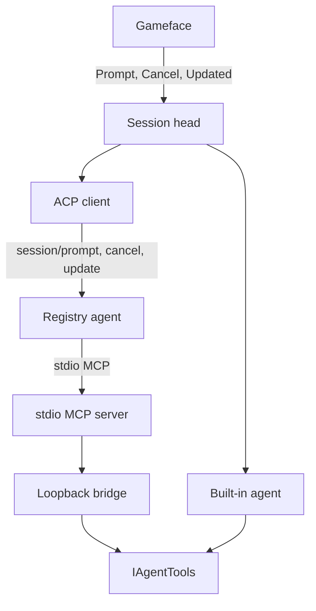

# AIRI Mayor


> Learn more at [Project AIRI](https://github.com/moeru-ai/airi) and the [live demo](https://airi.moeru.ai).

**AIRI Mayor** plays **Cities: Skylines II**. A Gameface chat in the game talks to an in-process Microsoft Agent Framework Harness that builds through the simulation thread. The built-in mayor uses the selected model provider; an external mayor is optional. Not listed on Paradox Mods yet.

- Vocabulary: [CONTEXT.md](./CONTEXT.md)
- Decisions: [docs/adr/](./docs/adr/)
- Open work: [docs/open-work.md](docs/open-work.md)
- Agent rules: [AGENTS.md](./AGENTS.md)
- Docs index: [docs/README.md](./docs/README.md)

## Session

In settings, choose **Built-in mayor** or **External agent** on the Mayor tab; city permissions have their own tab. The built-in mayor supports OpenAI, OpenCode Go, OpenRouter, Anthropic and custom OpenAI-compatible services. Each provider retains its own key, model and connection details. Fetch models refreshes only the list; advanced settings allow a manual model ID and separate catalog address. Apply starts a fresh chat with that connection. Existing flat connection settings must be entered again. See [ADR 0050](docs/adr/0050-model-provider-connections.md).

Gameface calls `Prompt`, `Cancel`, and the `update` stream. The default head is the built-in agent. City tools pass through `IAgentTools`. External mayors come from the ACP Registry and share one ACP session (`session/prompt`, `session/cancel`, `session/update`), with city tools supplied as a stdio MCP server. Refresh agents updates the cached catalog; first use prepares the selected registry version. Package agents need Node.js/npm or uv, and sign-in happens outside the game. City-only work is a prompt instruction; the mod does not restrict the agent's own tools. See [ADR 0032](docs/adr/0032-agent-runtime-tool-port.md), [ADR 0036](docs/adr/0036-external-mayor-acp.md) and [ADR 0049](docs/adr/0049-registry-external-mayors.md).

The built-in mayor uses native todos, compaction and background tasks. New messages join at the next model boundary; Stop cancels the root turn and its current city tool. A built-in background result is retrieved explicitly. Loading a city or applying settings opens an idle chat; neither head automatically starts work or repeats completed turns. External delegated reports retain their delivery to the root chat. Connection, model and tool choices take effect in a fresh chat when settings are applied. See [ADR 0048](docs/adr/0048-native-maf-harness.md).



## Build

Windows + the game. Full setup: [Windows onboarding](docs/guide/2026-08-06-windows-onboarding.md).

```bash
cd Mod
dotnet build
```

Enable **AIRI Mayor**, load a save; chat is bottom-right. UI-only: `cd Mod/UI && npm run build`. Offline POCs: [archive/](./archive/README.md).

## License

[Apache License 2.0](./LICENSE). The tool layer is an inlined adaptation of [CS2MCP](https://github.com/LancerComet/cities-skylines-2-mcp); attribution is in [NOTICE](./NOTICE). Portions of `CreateDefinitions.cs` remain under the Paradox Interactive EULA.
