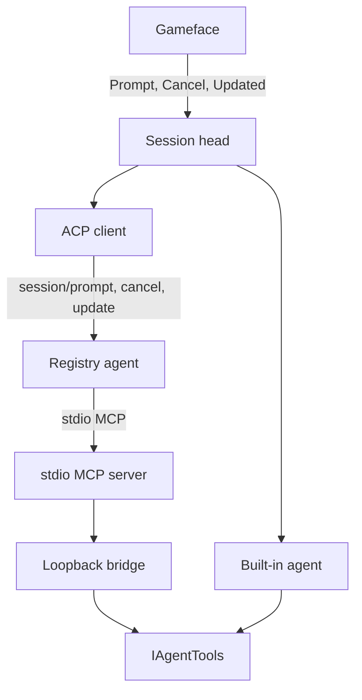

# AIRI Mayor


> Learn more at [Project AIRI](https://github.com/moeru-ai/airi) and the [live demo](https://airi.moeru.ai).

**AIRI Mayor** plays **Cities: Skylines II**. A Gameface chat in the game talks to an in-process Microsoft Agent Framework Harness that builds through the simulation thread. The built-in mayor uses the selected model provider; an external mayor is optional. Not listed on Paradox Mods yet.

- Vocabulary: [CONTEXT.md](./CONTEXT.md)
- Decisions: [docs/adr/](./docs/adr/)
- Open work: [docs/open-work.md](docs/open-work.md)
- Agent rules: [AGENTS.md](./AGENTS.md)
- Docs index: [docs/README.md](./docs/README.md)

## Session

In settings, choose **Built-in mayor** or **External agent** on the Mayor tab; city permissions have their own tab. The built-in provider and model lists come from Models.dev, filtered to supported protocols and city-tool capabilities. Pick a provider, key and model; the catalog supplies its address, protocol, context and output limits. A custom OpenAI-compatible connection remains available. Each provider retains its own local key, selection and overrides. Refresh model catalog updates the directory and cache; Check server models optionally checks current availability. Neither changes the selection or applies settings. Apply starts a fresh chat with a frozen connection. Version-1 connection settings must be entered again. See [ADR 0051](docs/adr/0051-models-dev-catalog-routing.md).

Gameface calls `Prompt`, `Cancel`, and the `update` stream. The default head is the built-in agent. City tools pass through `IAgentTools`. External mayors come from the ACP Registry and share one ACP session (`session/prompt`, `session/cancel`, `session/update`), with city tools supplied as a stdio MCP server. Refresh agents updates the cached catalog; first use prepares the selected registry version. Package agents need Node.js/npm or uv, and sign-in happens outside the game. City-only work is a prompt instruction; the mod does not restrict the agent's own tools. See [ADR 0032](docs/adr/0032-agent-runtime-tool-port.md), [ADR 0036](docs/adr/0036-external-mayor-acp.md) and [ADR 0049](docs/adr/0049-registry-external-mayors.md).

The built-in mayor uses native todos, compaction and background tasks. New messages join at the next model boundary; Stop cancels the root turn and its current city tool. A built-in background result is retrieved explicitly. Loading a city or applying settings opens an idle chat; neither head automatically starts work or repeats completed turns. External delegated reports retain their delivery to the root chat. Connection, model and tool choices take effect in a fresh chat when settings are applied. See [ADR 0048](docs/adr/0048-native-maf-harness.md).



## Build

Windows + the game. Full setup: [Windows onboarding](docs/guide/2026-08-06-windows-onboarding.md).

```bash
cd Mod
dotnet build
```

Enable **AIRI Mayor**, load a save; chat is bottom-right. UI-only: `cd Mod/UI && npm run build`. Offline POCs: [archive/](./archive/README.md).

Session evidence uses trace-kit records and assets under `ModsData/airimayor/sessions/`. Prepare the offline tools:

```bash
npm --prefix scripts/trace-kit ci
npm --prefix scripts/trace-kit run build
```

Open `scripts/trace-kit/viewer.html` in a browser and select one session folder containing `records.jsonl` and `assets/`. Inspect the execution timeline, root/background branches, model requests, city-tool evidence and images; use playback, step and seek to follow the recorded output. The page is self-contained and reads the selected local files. Interrupted recordings stay inspectable and are marked incomplete.

Metrics shows token coverage, weighted cache reuse, request context changes, compaction checkpoints, and tool timing and write-evidence summaries. Search finds content in records and referenced JSON/text files, combines agent/run/turn/outcome/tool filters, and opens evidence at the matching record. Analysis covers the whole recording; missing usage remains unavailable. See [ADR 0054](docs/adr/0054-offline-recording-analysis.md).

City opens with key readings and a population line trend, then offers finances, demand and factors, services, labor, notifications and individual road traffic by game time. Search for a road and choose its measure; inspect trends with the pointer or arrow keys, select a city time, and expand readings, actions or recorded images when needed. Source evidence opens beside the chart and closes back to the entry replay position. Cards retain the last observed date; missing readings and unknown history dates stay explicit. See [ADR 0055](docs/adr/0055-city-observations-in-replay.md).

For browser interaction checks, install Chromium once with `npx --prefix scripts/trace-kit playwright install chromium`, build the viewer, and run `npm --prefix scripts/trace-kit run test:ui`.

For automated validation, run `npm --prefix scripts/trace-kit run check -- "<session directory>"` (omit the directory for the latest recording). It validates the actual trace-kit format and attachments, projects the timeline, and judges city writes. Installation downloads a pinned upstream source snapshot; later viewing and checks work offline. See [ADR 0052](docs/adr/0052-trace-kit-session-records.md).

## License

[Apache License 2.0](./LICENSE). The tool layer is an inlined adaptation of [CS2MCP](https://github.com/LancerComet/cities-skylines-2-mcp); attribution is in [NOTICE](./NOTICE). Portions of `CreateDefinitions.cs` remain under the Paradox Interactive EULA.
