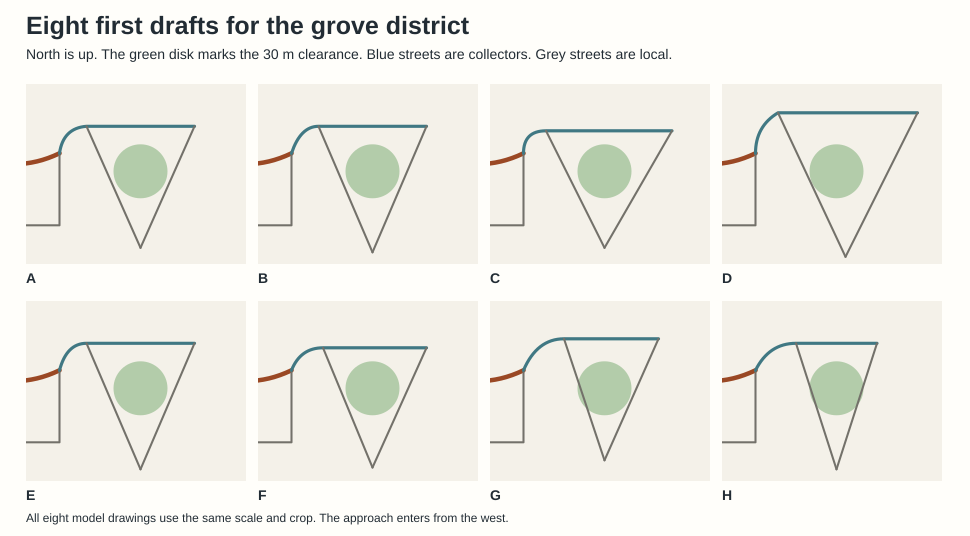

# Can editing a road design like SVG improve construction?

Status: frozen

Reviewed on 2026-11-20 at repository revision `2957d98`.

The working hypothesis is that an agent can revise a street more reliably if it can read the existing design, identify the junction or curve to change, and inspect the result. Two overlapping strokes can depict either a crossroads or an overpass. A useful road representation must capture whether traffic can turn there and what elevation the design requires. [W3C SVG 2, paths](https://www.w3.org/TR/SVG2/paths.html#PathData) · [Cities: Skylines II road tools](https://www.paradoxinteractive.com/games/cities-skylines-ii/features/road-tools)

## What this agent had to supply

At the reviewed revision, a `build_network` request described one connection. It could follow endpoint tangents, bend through one midpoint, or copy an existing road. To draw a street through several chosen places, the agent had to divide the design into calls and align each new piece with the last. Ground preflight sampled the proposed course across its width for water and along it for grade. A rejection explained why that course failed and left the next alignment to the caller. Measuring the contribution of that interface to a particular city's appearance requires its calls and resulting roads. [Connection design](../adr/0041-network-connection-shapes.md) · [Course builder at the reviewed revision](https://github.com/proj-airi/airimayor/blob/2957d987339b42c26f0c06a6a97d8a8fdf21fa5a/Mod/CS2MCP/NetworkCourseBuilder.cs#L86-L162) · [Ground preflight at that revision](https://github.com/proj-airi/airimayor/blob/2957d987339b42c26f0c06a6a97d8a8fdf21fa5a/Mod/CS2MCP/RoadGroundPreflight.cs)

The local November 10 session record contains nine completed `build_network` calls. Six specified road prefabs and all six omitted the shape. Five returned a placed straight segment and one returned `InvalidShape`. Three of those successful medium-road calls extended a chain through two repeated endpoint coordinates. The other three calls in the record built utilities. This sample shows what the mayor actually submitted and what the tool reported. It supplies neither a beauty rating nor a comparison against the same model drawing SVG.

## What others did

| Source | What the authors implemented | Lesson for roads |
| --- | --- | --- |
| [Wu et al., Chat2SVG, §3.1](https://openaccess.thecvf.com/content/CVPR2025/papers/Wu_Chat2SVG_Vector_Graphics_Generation_with_Large_Language_Models_and_Image_CVPR_2025_paper.pdf) | The model planned an entire composition using simple shapes. It inspected a rendered draft to correct alignment, proportion, and drawing order. | Give the agent enough scope to express the whole alignment. For visual review, show the resulting street in its surroundings. |
| [Colossal Order, CS2 road tools](https://www.paradoxinteractive.com/games/cities-skylines-ii/features/road-tools) | A player sets a grid with three clicks, previews it and can draw parallel roads at a fixed distance. Guides show slope, and road crossings can form intersections. | Preserve relationships such as a fixed offset or a shared junction throughout a design. Geometry and elevation determine what the game can realize. |
| [Parish and Müller, Procedural Modeling of Cities, §3.3 and fig. 8](https://people.eecs.berkeley.edu/~sequin/CS285/PAPERS/Parish_Muller01.pdf) | Their generator proposed a road, adjusted it against water and existing streets, reused nearby junctions and split existing edges at crossings. | A join changes the road graph. Explicitly verify that both roads share the intended junction. |
| [Galin et al., Procedural Generation of Roads, §4](https://perso.liris.cnrs.fr/egalin/Articles/2010-roads.pdf) | Candidate routes between the same endpoints received different costs for slope in the travel direction, water and curvature. | When the request leaves the alignment open, evaluate the route between its anchors. A dry destination says little about the intervening road. |
| [Sunwood AI Labs, CS1 road diagnostics](https://github.com/Sunwood-ai-labs/cities-skylines1-agent-skill/blob/70a5116215a4c83820134cca870aae1934e92d87/src/GameState.cs#L1395-L1447) | The agent's tools distinguished an ordinary dead end from a dead end near another road using the built network. | For a requested junction, read back connectivity. For an intentional cul-de-sac, a single connected edge is expected. See the [CS1 source audit](2026-08-13-cities-skylines1-agent-skill-road-planning.md). |

## How existing designs are edited

SVG elements may have unique IDs. A path's `d` attribute still contains an ordered sequence of commands and coordinates. If two paths happen to end at the same coordinates, editing one endpoint leaves the other path untouched. A road design could instead let two streets reference one junction and keep each curve's handles local to its street. Moving the junction would then have a different scope from reshaping one curve. [SVG element IDs](https://www.w3.org/TR/SVG2/struct.html#IDAttribute) · [SVG path commands](https://www.w3.org/TR/SVG2/paths.html#PathData)

OpenStreetMap's iD editor demonstrates that distinction in executable form. Moving a node looks it up by ID and replaces its position in the graph. Inserting a midpoint looks up ways sharing an edge and inserts the same new node into each matching way. Lanelet2's authors describe what happens after a point moves. Every referencing object observes the change, while cached centerlines and search indexes can still describe the old map. A proposed road edit needs to show the affected streets as well as the selected object. [iD move node](https://github.com/openstreetmap/iD/blob/c797cd72707bac9d7122e2efaf10131bcf6e2eac/modules/actions/move_node.ts) · [iD add midpoint](https://github.com/openstreetmap/iD/blob/c797cd72707bac9d7122e2efaf10131bcf6e2eac/modules/actions/add_midpoint.ts) · [Lanelet2 data sharing](https://github.com/fzi-forschungszentrum-informatik/Lanelet2/blob/master/lanelet2_core/doc/Architecture.md#data-sharing)

Access to source has limits. SVGEditBench V2 evaluated edits to existing emoji SVGs from a visible change request and found successes and failures. A later preprint, Vector-Bench, required both the requested repairs and preservation of unrelated content. On its 40 difficult tasks, the best of 34 endpoints fully satisfied 15%. These results motivate checking local road edits for collateral changes. A CS2 experiment would need its own baseline. [SVGEditBench V2](https://arxiv.org/abs/2502.19453) · [Vector-Bench](https://arxiv.org/abs/2607.19056)

**Before construction**, a named design can be edited repeatedly, inspected at city scale and discarded at the cost of computation. The main question is whether shared junctions and local curve edits improve the agent's results enough to justify another representation. A short change to an individual straight road may already have a sufficient interface.

**After construction**, a player may have inserted a junction, changed a road or removed it since the design was read. Replaying the original document could undo that work. OpenStreetMap checks identity and version before updating an object. An analogous CS2 experiment would re-read the affected geometry and connections, detect stale assumptions, and report what the native tool actually built. Persisting a second copy of the entire city adds reconciliation costs. Reading a fresh, bounded design from the live graph for each edit is a competing approach. [OpenStreetMap update consistency checks](https://github.com/openstreetmap/openstreetmap-website/blob/master/app/models/concerns/consistency_validations.rb#L9-L16) · [Native validation](../adr/0002-native-validation.md)

## Experiment that could reject the hypothesis

Two other network formats inform the choice of what the agent edits. Eclipse SUMO exposes a plain network of named nodes, edges and optional connections for authoring and patching. Its compiler produces the simulation network, including generated junction details. ASAM OpenDRIVE explicitly models road links and junctions alongside plan-view geometry. The benchmark borrows editable road identities and explicit connectivity. CS2 can continue to own lane and junction construction. [SUMO PlainXML](https://sumo.dlr.de/docs/Networks/PlainXML.html) · [OpenDRIVE road linkage](https://publications.pages.asam.net/standards/ASAM_OpenDRIVE/ASAM_OpenDRIVE_Specification/v1.8.1/specification/10_roads/10_03_road_linkage.html)

Use the same model, instructions, tool-call budget, time budget and starting city snapshot. Compare the existing tools against edits by name on a readable local road graph. Give both conditions the same map and native feedback. In a separate comparison, add a rendered draft to both conditions to measure the effect of visual feedback. Use several runs per instruction and hide the interface used from the person comparing the resulting maps.

| Requested edit | Evidence of success |
| --- | --- |
| Soften one bend in an existing S-shaped street. | Both endpoints stay fixed, the specified bend changes in the requested direction, and the adjoining street retains its alignment. |
| Move a T-junction 16 m east. Keep all three arms and the nearby overpass. | All three arms share one junction at the requested location. The overpass remains grade-separated. Unrelated streets retain their geometry and connections. |
| Apply an edit after the player splits the target street or removes it. | The player’s new connection survives. A stale or ambiguous edit produces a specific conflict or a fresh proposal based on current geometry. |

Score edit correctness, collateral changes, retries and native rejection separately. For an unbuilt design, inspect the document diff and rendered view. For a built road, read the actual network after construction. If named edits improve draft quality alone, that finding supports a design editor. A live synchronization module would still need evidence from the built-road cases. [Network graph](../adr/0009-typed-network-graph.md)

## Offline experiment on November 20

The Vieval pilot crossed two choices on the same street document. Coordinates repeat a junction position in each incident path. References give that position one name. In both representations an agent could either replace complete rows by removing and adding them, or patch individual fields. All four conditions had the same street IDs, hierarchy, elevations, drawing primitives and access to the complete starting district. This controls for having a readable design in the first place. The current in-game tool does not offer that same starting point. [Runnable benchmark](../../scripts/road-edit-eval/README.md)

Vieval 0.11.1 ran six tasks twice per condition using Codex CLI 0.169.1, `gpt-6.2-sol` and low reasoning effort. Each independent call saw only the synthetic document and its instructions. The grove task gave the model freedom to choose alignments, then asked it to revise its own successful draft. Across 48 episodes there were 54 model responses, with no runner failures. The primary score required all three checks to pass. A separate five-task exploratory run preceded the reported experiment and is excluded below. [Cases and graders](../../scripts/road-edit-eval/cases.mjs) · [Archived responses and prompt hashes](../../scripts/road-edit-eval/pilot-2026-11-20.jsonl)

| Representation | Operation | All checks | Junctions correct | Other roads preserved | Median response bytes for the four local edits |
| --- | --- | ---: | ---: | ---: | ---: |
| Coordinates | Rebuild | 12/12 | 12/12 | 12/12 | 192.5 |
| Coordinates | Edit | 12/12 | 12/12 | 12/12 | 90 |
| References | Rebuild | 11/12 | 12/12 | 12/12 | 159.5 |
| References | Edit | 11/12 | 12/12 | 12/12 | 73.5 |

Bytes count the UTF-8 answer after removing optional JSON whitespace. Each median covers eight initial replies. Patching cut the size of the returned change in both representations. In one concrete edit, a single shared point moved two streets. Each editing operation achieved 23/24 exact episodes. Both losses occurred on the first grove drawing. The closest sampled road centrelines were 25.3 m and 27.6 m from the centre against a 30 m minimum. All six drawings eligible for the second instruction passed it. Road membership and collateral geometry were correct in every episode.

Panels A, C, E and F used coordinates. B, D, G and H used references. The clearance failures are G and H. All eight drawings used straight lines for both local streets, producing a triangular block. The brief prescribed the three-street loop and allowed the local streets to curve. An open-ended brief and blinded player ratings would be needed to compare visual variety or appeal.

The evidence supports trying a readable district document with small edits. It shows an advantage in how much the model has to rewrite. It leaves open whether patching improves accuracy or visual quality. The observed advantage for literal coordinates is two first drafts on one site. A promising next comparison would let both representations inspect the same rendered draft and receive the same offending street, closest position and clearance measurement before revising it. Diverse sites, blinded visual preference and additional models would address questions the single-site pilot leaves open. Adopting a production road language or synchronizing already-built roads would be a separate decision.
