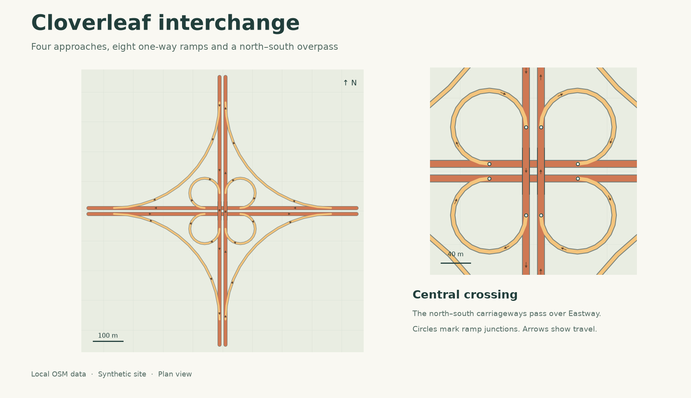

# Can an agent edit a Cities: Skylines II district through an OSM file?

Status: frozen

An OSM document can describe which streets meet, the direction of a ramp and the outline of a building. The promising experiment is to export a bounded district, edit the same objects locally, preview the proposed changes at several scales, then apply only the requested changes through the game. Success would mean a particular edit survived construction and a fresh export. Reading and writing valid XML establishes only the first step. [OSM elements](https://wiki.openstreetmap.org/wiki/Elements) · [Native construction](../adr/0002-native-validation.md)

## Four direct XML edits

Each task used a fresh GPT-6.2-Sol session at medium reasoning effort. Input was an English brief and the complete starting OSM XML. We kept the first answer, checked that it made no tool calls, applied its OsmChange XML locally and rendered the resulting coordinates. The model received no rendered view. The sites use synthetic equatorial coordinates. The prompts, baseline files, raw answers and measurements are linked from the [trial manifest](examples/2026-11-21-osm/trials.json).

| Task | Starting information | Observed result |
| --- | --- | --- |
| [Connect divided highways](examples/2026-11-21-osm/interchange.osm) | Two straight divided highways and an existing central bridge. The brief named a cloverleaf and gave the terminal directions. Candidate junctions were already on the mainlines. | Eight new one-way ramps. All four straight movements used only the mainlines. Each of the eight turns used one dedicated ramp. The four carriageway crossings at the bridge had no shared node. There were no unconnected centerline crossings at the same level. OSMnx independently read 144 nodes and 148 directed edges. |
| [Choose the ramp junctions](examples/2026-11-21-osm/interchange-unmarked.osm) | Same through geometry and bridge. Only the outside terminals and bridge ends remained in the input. | The agent inserted junctions into six existing ways and preserved their centerlines, directions and tags. Again all twelve movements worked, with no unconnected same-level crossings. The sharpest change of heading between successive ramp segments, including joins, rose from 15° to 22.5°. These angles describe the sampled polylines. |
| [Lay out a district](examples/2026-11-21-osm/district.osm) | One existing street with four nodes and a 360 × 280 m site. The agent chose the internal layout. | Two connections to the existing street, four enclosed blocks, a curved residential street, one park and seven building footprints including the school. Polygons were valid, inside the site and clear of one another and every road centerline. The result visibly repeats rectangular buildings and straight streets. [Both first drawings](examples/2026-11-21-osm/direct-edits.png) |
| [Move a junction and a school](examples/2026-11-21-osm/district-edit.osc) | The preceding district with local positive IDs. The brief specified a 4 m westward move for a named shared junction, a 3 m eastward translation for the school and a second floor. | The junction moved 3.996 m west. All four school corners moved 3.006 m east and the school way gained `building:levels=2`. All 59 other objects retained their content, the four enclosed blocks survived and the footprints stayed clear. [Edited district](examples/2026-11-21-osm/district-revised.osm) |

For routing, enumerate all ordered pairs of terminal directions other than U-turns. For each turn, require a directed mainline path to a ramp's first reference and from that same ramp's last reference to the destination. This prevents a detour around multiple ramps from counting as a working turn. For blocks, polygonize street centerlines and count bounded faces. For the local revision, compare every ID, coordinate, node reference and tag against the baseline. A reference to the same node lets one coordinate edit move both connected streets. These four first answers establish examples of feasibility. Repeated runs, irregular sites and blind reviews are still needed to measure reliability and design quality.

## What survives the exchange

| Feature | What the agent can read and edit | What construction still needs |
| --- | --- | --- |
| Streets and junctions | A way references an ordered list of nodes. Two roads can share a junction node. Nodes used only to shape a way need no game junction. | A reversible mapping between game meters and latitude/longitude, the native prefab, and the original curve and endpoint identities. A sampled curve does not determine its exact Bézier handles. [OSM XML](https://wiki.openstreetmap.org/wiki/OSM_XML) · [Native road shapes](../adr/0041-network-connection-shapes.md) |
| Interchanges | Directed carriageways and link ways describe ramps. A flyover crosses without sharing a junction. Bridge, tunnel and layer tags describe the crossing order. Turn-restriction relations can constrain movements at a junction. | Deck heights in meters, clearance, approach grades and compatible native lanes. The relative order in `layer` gives no height profile. Verify each intended directed movement in the realized network. [Link roads](https://wiki.openstreetmap.org/wiki/Tag:highway%3Dmotorway_link) · [Layer](https://wiki.openstreetmap.org/wiki/Key:layer) · [Turn restrictions](https://wiki.openstreetmap.org/wiki/Relation:restriction) |
| Buildings | A footprint can carry a use, height, number of floors and building parts. | Several assets can fit one footprint. Existing buildings need a binding to the selected instance. A new building needs an available prefab, position, orientation and a site accepted by the game. [Simple 3D Buildings](https://wiki.openstreetmap.org/wiki/Simple_3D_Buildings) · [Building placement](../adr/0003-one-step-building-placement.md) |

Local experience illustrates the information loss. The current map painter joins same-style segments along shared native nodes, draws them with a length-weighted width, and exports a rendered PNG. A street-shaped stroke can cover several native objects. Carto exports game features to GeoJSON, Shapefile and GeoTIFF. In the other direction, the author of a published Yilan map reports importing OSM roads with Earth2Cities, then calculating bridge lift and clearance separately. Each is evidence for one conversion direction. [Map assembly](../adr/0025-map-image-native-node-ways.md) · [Map rendering](../adr/0020-osm-carto-map-image.md) · [Carto](https://github.com/taipei-native/Carto) · [Yilan map workflow](https://github.com/WFMinerva/cs2-real-map-toolkit)

## Editing locally

JOSM opens and saves a local `.osm` document. Its `upload="never"` layer setting disables public upload for fictional data. An `.osc` file carries create, modify and delete operations. It usually omits objects that it references but leaves untouched, so retain the baseline extract, including nodes and relation members required by the edit. Protect roads cut by the boundary from accidental deletion. [JOSM Save](https://josm.openstreetmap.de/wiki/Help/Action/Save) · [JOSM upload settings](https://josm.openstreetmap.de/wiki/Help/Action/EncourageDiscourageUpload) · [OsmChange](https://wiki.openstreetmap.org/wiki/OsmChange) · [Pyosmium formats](https://docs.osmcode.org/pyosmium/latest/user_manual/07-Input-Formats-And-Other-Sources/)

Keep a city-specific baseline that binds editable object IDs to the exact game geometry and relationships read at export. An unchanged object should cause zero native writes. For a changed object, compare the intended edit against the live affected streets and junctions, including attachments added by the player. Report conflicts and read back the actual result. If a multi-street write stops partway, the next attempt must account for everything already built. Osmium's `derive-changes` compares type, ID and version only. An offline coordinate or tag edit with the same version can disappear from that diff. Compare full object content when generating a patch from local documents. [Osmium derive-changes](https://docs.osmcode.org/osmium/latest/osmium-derive-changes.html) · [OSM update consistency](https://github.com/openstreetmap/openstreetmap-website/blob/master/app/models/concerns/consistency_validations.rb)

## What a local map can show

OSM supplies the features. OpenStreetMap Carto defines a Mapnik style. Planetiler can turn geographic data into vector tiles, OpenMapTiles defines feature layers and attributes, and MapLibre draws sources with filters and zoom limits. A local renderer can also draw a bounded GeoJSON view directly. A city overview can emphasize arterial roads while a close-up exposes ramps and building outlines. Features omitted or simplified upstream cannot be recovered by zooming or changing paint. Keep the complete editable graph behind both views. Verify clearance, available turns and building access in the game. [OpenStreetMap Carto](https://github.com/gravitystorm/openstreetmap-carto) · [Planetiler](https://github.com/onthegomap/planetiler) · [OpenMapTiles schema](https://openmaptiles.org/docs/schema/) · [MapLibre sources](https://maplibre.org/maplibre-style-spec/sources/) · [MapLibre layers](https://maplibre.org/maplibre-style-spec/layers/)

## Offline comparison before a game adapter

Run a paired Vieval comparison on unseen sites using the existing per-segment action interface, the junction-based representation from the previous pilot and OSM. Give them equivalent geometry, turn and building capabilities in the offline simulator. Hold the model, instructions, starting geometry, budget and rendering constant. Cross each representation with and without a rendered preview and one opportunity to revise. Report paired results across site seeds and repeated runs. The [previous pilot](2026-11-20-road-generation.md) tested a different representation on smaller tasks.

Rotate the highways, skew the crossing and reserve a parcel in one quadrant. Ask for the same twelve movements. Score route correctness, same-level crossings, minimum curve radius and merge spacing. In a district, ask for a curved collector, local streets, distinct blocks and service frontage while preserving an existing neighborhood. Score block size distribution, viable frontage with road widths included, exact preservation and unintended changes. Give reviewers anonymized maps at the same two scales to judge hierarchy, curves and composition. Keep those judgments alongside the geometry results so that a regular grid cannot win on connectivity alone.

Replay a local move and an unchanged document against a simulated city. Require zero writes for the unchanged document, idempotent replay, preservation of untouched curves and detection of a conflicting player edit. These tests exercise the proposed translation independently of whether CS2 accepts construction.

## Comparison on a fresh city

Use the same starting save, instruction, model, map extent, time and call budget for existing tools and OSM edits. Repeat each task. Test the effect of multiscale visual feedback separately by giving it to both groups. Hide which interface produced each map during visual review.

| Task | Evidence to collect |
| --- | --- |
| Export, reopen and reapply without edits. | Zero native writes and zero changed streets or buildings. Re-export and compare topology, exact native curves, prefab, direction and elevation with the first snapshot. |
| Add a curved collector and local streets around an existing school. | Connected blocks, buildable frontage, requested connections, school access, intact neighboring buildings and streets through the export boundary. Compare the district plan and a close-up of each junction. |
| Add a directional ramp between divided highways across another road. | Travel from the specified origin to destination, preservation of existing movements, no junction at the flyover, adequate measured clearance, and game-accepted grades. Examine the crossing in profile as well as plan. |
| Edit a district after a player splits a target road and adds a side street. Interrupt a later construction step and repeat the request. | The new junction and unrelated edits survive. Stale intent is identified or reconciled. Every accepted segment is accounted for once after retry and re-export. |

Record target completion, unintended changes, failed placements, calls and visual scores separately. A correct file round trip measures document editing. Player-supplied logs, map views and realized network facts measure whether the same task worked in the game. [Graph diagnostics](../adr/0009-typed-network-graph.md) · [Live acceptance](../open-work.md)
